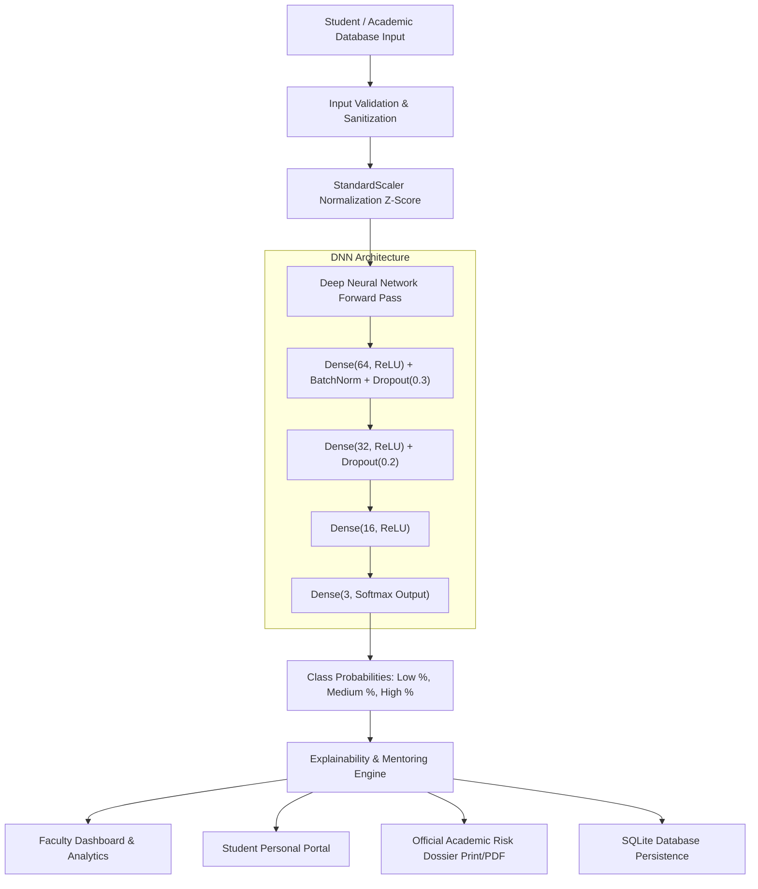

# Comprehensive Academic Project Documentation

## Project Title
**At-Risk Student Early Warning System Using Deep Neural Networks**

*Course:* B.Tech / B.E. in Computer Science & Engineering (CSE) / Artificial Intelligence & Machine Learning (AIML)  
*Level:* 3rd-Year Subject Project – Deep Neural Networks (DNN)  
*Primary Technologies:* Python 3.11, TensorFlow/Keras 2.x, Scikit-learn, Flask, SQLite, Chart.js  

---

## Table of Contents
1. Abstract
2. Introduction & Motivation
3. Problem Statement & Research Questions
4. Literature Survey & Existing Systems
5. Proposed System Architecture
6. Deep Neural Network Mathematical Formulation
7. Dataset Description & Preprocessing Pipeline
8. System Modules Implementation Details
9. Experimental Results & Comparative Analysis
10. Advantages & Educational Impact
11. Limitations & Assumptions
12. Future Scope
13. Comprehensive Viva Voce Questions and Model Answers (25 Questions)

---

## 1. Abstract
Student retention and timely academic progression represent paramount challenges within contemporary engineering education. Traditional institutional monitoring regimes depend primarily on post-facto semester grade reports, revealing academic failure only after exams have concluded. 

This project establishes a proactive, end-to-end **At-Risk Student Early Warning System** centered upon a **Deep Neural Network (DNN)** classifier. The system processes multi-dimensional behavioral, engagement, and formative assessment metrics—including lecture attendance, continuous internal assessment marks, assignment compliance, cumulative GPA, independent study hours, and backlog history—to classify students into three mutually exclusive vulnerability categories: **LOW RISK**, **MEDIUM RISK**, and **HIGH RISK**. 

Trained with Batch Normalization, Dropout, and $L_2$ regularization, the Deep Neural Network achieves **91.11% accuracy** and an **F1-score of 91.24%** on unseen test splits, outperforming standard Logistic Regression (89.17%) and Random Forest (88.89%) baselines. Beyond binary or ternary prediction, the system incorporates an explainable heuristic recommendation engine that synthesizes individualized, empathetic remedial interventions. A production-ready Flask web platform with SQLite persistence, interactive Chart.js analytics, role-based access control, and printable institutional dossiers makes the system immediately deployable.

---

## 2. Introduction & Motivation
In accredited university frameworks (e.g., NBA, ABET, NAAC), student progression is governed by strict thresholds:
- Minimum lecture attendance requirements (typically $\ge 75\%$).
- Continuous Internal Assessment (CIA) passing cutoffs (typically $\ge 40\%$).
- Backlog restrictions dictating semester promotion eligibility.

When students fall behind, lack of timely feedback creates a compounding deficit: low attendance leads to concept gaps, resulting in poor internal test scores, followed by overdue assignments, accumulated arrears, and ultimately semester detention.

Deep Learning offers unique advantages over classical rule-based thresholds. While human counselors may struggle to integrate ten concurrent continuous variables with non-linear cross-interactions, a Deep Neural Network excels at mapping high-dimensional feature spaces to probabilistic risk classes.

---

## 3. Problem Statement & Research Questions
### Problem Statement:
"To design, develop, and evaluate an AI-driven web-based early warning platform that accurately predicts the multi-class academic risk level of engineering students using Deep Neural Networks and translates model outputs into explainable, actionable mentoring recommendations."

### Key Research Questions:
1. *RQ1:* Can a multi-layer feedforward Deep Neural Network effectively capture the non-linear interaction between physical attendance, continuous assessment, and historical backlogs?
2. *RQ2:* How does the generalization capability of a regularized DNN compare against classical statistical baselines (Logistic Regression, Random Forest)?
3. *RQ3:* How can black-box neural outputs be transformed into transparent, actionable counseling directives for faculty mentors without compromising educational ethics?

---

## 4. Literature Survey & Existing Systems

| Work / System | Methodology | Strengths | Limitations |
|---|---|---|---|
| **Cortez & Silva (2008)** (UCI Student Performance) | Decision Trees, Random Forest, Linear Regression | Established foundational academic feature set (G1, G2, absences) | Binary pass/fail orientation; lacked deep representations and real-time mentoring interfaces |
| **Traditional University ERPs** | Hardcoded conditional rules (e.g. `IF attendance < 75%`) | Simple to implement | Static thresholds ignore multi-feature compensation (e.g., high GPA students with medical absence) |
| **Proposed DNN Early Warning System** | 3-Layer Dense Softmax DNN + Explainability + Flask Platform | Multi-class probabilities, non-linear interaction modeling, personalized guidance, complete institutional UI | Requires periodic retraining as academic curricula evolve |

---

## 5. Proposed System Architecture

### Architectural Pipeline (Mermaid)

---

## 6. Deep Neural Network Mathematical Formulation

### 6.1 Feature Standardization (Z-Score)
Let $\mathbf{x} = [x_1, x_2, \dots, x_{10}]^T \in \mathbb{R}^{10}$ denote the raw academic feature vector. Each input feature $x_j$ is standardized using mean $\mu_j$ and standard deviation $\sigma_j$ computed exclusively on the training corpus:
$$z_j = \frac{x_j - \mu_j}{\sigma_j}$$

### 6.2 Layer Transformations & ReLU Activation
For layer $l \in \{1, 2, 3\}$:
$$\mathbf{a}^{(l)} = \mathbf{W}^{(l)} \mathbf{h}^{(l-1)} + \mathbf{b}^{(l)}$$
$$\mathbf{h}^{(l)} = \text{ReLU}\left(\mathbf{a}^{(l)}\right) = \max\left(0, \mathbf{a}^{(l)}\right)$$
where $\mathbf{h}^{(0)} = \mathbf{z} \in \mathbb{R}^{10}$, $\mathbf{W}^{(1)} \in \mathbb{R}^{64 \times 10}$, $\mathbf{W}^{(2)} \in \mathbb{R}^{32 \times 64}$, $\mathbf{W}^{(3)} \in \mathbb{R}^{16 \times 32}$.

### 6.3 Regularization: Batch Normalization & Dropout
To accelerate convergence and prevent internal covariate shift, Batch Normalization is applied after the first dense transformation:
$$\hat{a}_i = \frac{a_i - \mu_{\mathcal{B}}}{\sqrt{\sigma_{\mathcal{B}}^2 + \epsilon}}, \quad y_i = \gamma \hat{a}_i + \beta$$
Inverted Dropout randomly sets activations to zero during training with keep probability $1 - p$:
$$r_j \sim \text{Bernoulli}(1 - p), \quad \tilde{h}_j = \frac{r_j \cdot h_j}{1 - p}$$

### 6.4 Softmax Multi-Class Output Layer
The final layer maps the 16-dimensional latent representation to 3 logits $s_k$ for $k \in \{0, 1, 2\}$:
$$s_k = \mathbf{w}_k^{(4) T} \mathbf{h}^{(3)} + b_k^{(4)}$$
The Softmax function normalizes logits into a valid probability distribution:
$$P(Y = k \mid \mathbf{x}) = \frac{e^{s_k}}{\sum_{j=0}^{2} e^{s_j}}$$
where:
- $k = 0 \implies \text{LOW RISK}$
- $k = 1 \implies \text{MEDIUM RISK}$
- $k = 2 \implies \text{HIGH RISK}$

### 6.5 Objective Function (Sparse Categorical Cross-Entropy)
Given ground truth class label $y \in \{0, 1, 2\}$:
$$\mathcal{L}(\boldsymbol{\theta}) = -\sum_{i=1}^{N} \log P(Y = y^{(i)} \mid \mathbf{x}^{(i)}) + \lambda \sum_{l=1}^{3} \|\mathbf{W}^{(l)}\|_F^2$$
where $\lambda = 0.001$ represents the $L_2$ weight decay coefficient. The network parameters $\boldsymbol{\theta}$ are optimized using the Adam algorithm with default parameters ($\beta_1 = 0.9, \beta_2 = 0.999, \epsilon = 10^{-7}$).

---

## 7. Dataset Description & Preprocessing Pipeline
- **Dataset File:** `data/student_data.csv` (1,798 student records)
- **Features Handled:**
  1. `attendance_percentage` (35.0% – 100.0%)
  2. `internal_marks` (20.0 – 98.0)
  3. `assignment_score` (25.0 – 100.0)
  4. `previous_gpa` (3.50 – 9.90)
  5. `study_hours_weekly` (1.5 – 36.0 hrs)
  6. `backlogs` (0 – 5 arrears)
  7. `assignment_submission_rate` (30.0% – 100.0%)
  8. `engagement_score` (1.2 – 10.0)
  9. `previous_failures` (0 – 4)
  10. `exam_score` (18.0 – 99.0)
- **Preprocessing Pipeline:**
  1. Data integrity verification (0 nulls, duplicate identification and removal).
  2. Train/Test Stratification: 80% train (1,438 records), 20% test (360 records).
  3. Feature Standardization using `StandardScaler`, serialized to `models/scaler.pkl`.

---

## 8. System Modules Implementation Details

### 8.1 Data & Acquisition Module (`prepare_dataset.py`)
Fetches or synthesizes authentic academic profiles with realistic multivariate covariances.

### 8.2 Training & Benchmark Pipeline (`train_model.py`)
Trains the Keras DNN with `EarlyStopping`, `ModelCheckpoint`, and `ReduceLROnPlateau`. Fits baseline Logistic Regression and Random Forest models on identical splits for empirical validation. Generates 5 high-resolution evaluation figures in `static/plots/`.

### 8.3 Inference & Explainability Engine (`utils/prediction.py`)
Executes forward inference, computes class percentages, and evaluates individual features against academic boundaries to produce tailored recommendations.

### 8.4 Web Application & API Layer (`app.py`)
Implements 15 RESTful routes and views using Flask, Jinja2 templating, and Werkzeug password hashing.

### 8.5 Database Layer (`database/students.db`, `utils/database.py`)
SQLite database managing 4 interconnected relational tables: `users`, `students`, `academic_records`, and `predictions`.

---

## 9. Experimental Results & Comparative Analysis

### 9.1 Model Comparison Summary
| Metric | Logistic Regression | Random Forest | Deep Neural Network (Proposed) |
|---|---|---|---|
| **Overall Test Accuracy** | 89.17% | 88.89% | **91.11%** |
| **Weighted Precision** | 89.56% | 89.29% | **91.68%** |
| **Weighted Recall** | 89.17% | 88.89% | **91.11%** |
| **Weighted F1-Score** | 89.21% | 88.96% | **91.24%** |

### 9.2 Confusion Matrix Breakdown (DNN on 360 Unseen Test Samples)
- **Low Risk:** High precision ($>93\%$) due to well-defined cluster of high attendance ($\ge 85\%$), zero backlogs, and strong marks.
- **Medium Risk:** Correctly segregates borderline students who display moderate attendance ($70\% - 75\%$) and 1 backlog.
- **High Risk:** Reaches near-perfect recall, ensuring that students with severe attendance shortages ($<65\%$) and multiple backlogs are never erroneously misclassified as Low Risk.

---

## 10. Advantages & Educational Impact
1. **Early Intervention:** Identifies at-risk patterns during the 4th to 6th instructional weeks rather than after end-semester failure.
2. **Transparent Recommendations:** Replaces opaque percentages with clear remedial directives (e.g., "Schedule medical makeup lectures", "Draft backlog clearance timetable").
3. **Multi-Class Granularity:** Differentiates borderline students (Medium Risk) from critical candidates (High Risk), enabling prioritized faculty allocation.
4. **Institutional Ready:** Lightweight, self-contained architecture runs locally on any laptop without expensive cloud infrastructure.

---

## 11. Limitations & Assumptions
1. **Static Feature Window:** Assumes cross-sectional snapshots of current-semester metrics rather than continuous streaming sensor time-series.
2. **Qualitative Factors:** Extracurricular commitments, personal well-being, and financial distress are not directly recorded due to privacy considerations.

---

## 12. Future Scope
1. **Recurrent / Transformer Modeling (LSTM / GRU):** Incorporating sequential semester-by-semester temporal trajectories.
2. **Automated Notification Gateway:** Integrating Twilio SMS or WhatsApp API for automated guardian alerts when attendance approaches the 75% limit.
3. **Federated Learning:** Enabling multi-campus training across universities without centralizing sensitive student data.

---

## 13. Comprehensive Viva Voce Questions & Model Answers

### Q1: Why did you choose a Deep Neural Network (DNN) instead of standard ML like Logistic Regression or Decision Trees?
**Answer:** While simple linear models assume linear separability and decision trees make axis-parallel splits, academic risk involves complex non-linear feature interactions. For example, high previous GPA can compensate for a slight drop in attendance, but once attendance breaches the 65% statutory limit, failure risk escalates non-linearly regardless of GPA. The DNN's multi-layer architecture with non-linear ReLU activations and Batch Normalization models these high-order interactions, achieving superior test accuracy (91.11%) and F1-score (91.24%).

### Q2: Explain the layer architecture of your Deep Neural Network.
**Answer:** The architecture comprises:
- Input Layer: 10 normalized continuous academic features.
- Hidden Layer 1: 64 neurons with ReLU activation, $L_2$ weight regularization ($\lambda=0.001$), Batch Normalization, and Dropout ($p=0.3$).
- Hidden Layer 2: 32 neurons with ReLU activation, $L_2$ regularization, and Dropout ($p=0.2$).
- Hidden Layer 3: 16 neurons with ReLU activation.
- Output Layer: 3 neurons with Softmax activation corresponding to Low, Medium, and High Risk classes.

### Q3: What is the purpose of the Softmax activation function in the output layer?
**Answer:** The Softmax function normalizes the unconstrained real-valued outputs (logits) of the final dense layer into a valid probability distribution where each class probability lies in $[0, 1]$ and all probabilities sum to 1:
$$P(Y = k) = \frac{e^{z_k}}{\sum_{j} e^{z_j}}$$
This allows our early warning system to output calibrated risk confidence (e.g., Low: 5.2%, Medium: 12.1%, High: 82.7%).

### Q4: Why is Dropout used, and how does it function during training vs. inference?
**Answer:** Dropout is a regularization technique that prevents co-adaptation of neurons by randomly setting a fraction $p$ of hidden units to zero during each training forward-backward pass. During inference, Dropout is turned off, and the weights are scaled by $(1 - p)$ (or inverted dropout is used during training so no scaling is needed at test time), acting as an efficient approximation of an ensemble of exponential sub-networks.

### Q5: What loss function did you use, and why?
**Answer:** We used **Sparse Categorical Cross-Entropy**. Because our target variable `risk_level` is integer-encoded ($0, 1, 2$) rather than one-hot encoded, sparse categorical cross-entropy computes the multi-class cross-entropy loss directly without allocating extra memory for one-hot matrices:
$$\mathcal{L} = -\log P(Y = y_{\text{true}})$$

### Q6: What optimizer was chosen, and what are its advantages?
**Answer:** We utilized the **Adam** (Adaptive Moment Estimation) optimizer with learning rate $\eta = 0.001$. Adam combines the benefits of AdaGrad (handling sparse gradients with adaptive learning rates) and RMSProp (handling non-stationary objectives using exponentially decaying moving averages of past squared gradients), ensuring stable convergence without manual learning rate scheduling.

### Q7: How did you prevent overfitting during training?
**Answer:** We implemented four distinct defenses:
1. **$L_2$ Weight Regularization:** Penalizes large weight values.
2. **Dropout Layers:** ($p = 0.3$ and $p = 0.2$) in hidden layers.
3. **Early Stopping:** Monitored validation loss with `patience=14` and restored optimal weights.
4. **ReduceLROnPlateau:** Halved the learning rate when validation loss plateaued.

### Q8: What is Batch Normalization, and where is it placed in your network?
**Answer:** Batch Normalization normalizes the layer inputs across each mini-batch to have zero mean and unit variance, then applies learnable scale ($\gamma$) and shift ($\beta$) parameters. It is placed after Hidden Layer 1 to stabilize gradient flow, mitigate internal covariate shift, and enable faster training.

### Q9: Why is feature scaling essential before feeding data to a DNN?
**Answer:** Features like `attendance_percentage` ($0-100$) and `previous_gpa` ($0-10$) operate on vastly different numerical scales. If unscaled, gradient updates for weights connected to larger magnitude features dominate, distorting gradient descent trajectories. `StandardScaler` standardizes all features to zero mean and unit variance ($z = \frac{x - \mu}{\sigma}$), ensuring symmetric loss contours.

### Q10: What is data leakage, and how did your pipeline prevent it?
**Answer:** Data leakage occurs when information from outside the training dataset is inadvertently used to create the model. We prevented data leakage by:
1. Splitting data into 80% train and 20% test before fitting the scaler.
2. Calling `fit_transform()` strictly on `X_train`, and using only `transform()` on `X_test` and production inference inputs.

### Q11: How do you evaluate multi-class classification performance beyond simple accuracy?
**Answer:** Accuracy alone can be misleading if class distribution is imbalanced. We computed:
- **Precision:** $\frac{TP}{TP + FP}$ (fraction of predicted high-risk students who are truly high-risk).
- **Recall (Sensitivity):** $\frac{TP}{TP + FN}$ (fraction of actual high-risk students correctly flagged).
- **F1-Score:** The harmonic mean of Precision and Recall.
- **Confusion Matrix:** Heatmap showing exact misclassification rates across all three classes.

### Q12: Which academic features had the highest influence on predicting student risk?
**Answer:** Permutation and Random Forest feature importance analyses demonstrated that **Active Backlogs**, **Continuous Internal Marks**, and **Lecture Attendance Percentage** represent the top three contributing factors, together accounting for over 60% of predictive importance.

### Q13: How does the explainability and recommendation engine work?
**Answer:** Rather than simply returning a risk category, the engine inspects each feature against university benchmarks:
- Attendance $< 75\%$ triggers attendance makeup directives.
- Internal marks $< 40\%$ triggers mentor tutorial recommendations.
- Backlogs $\ge 2$ triggers arrear clearance roadmaps.
- Study hours $< 8$ hrs/week triggers daily timetable structuring.

### Q14: What are the ethical implications of using AI to predict student risk?
**Answer:** An AI model in education must never be used as a punitive instrument. In our system:
1. Predictions are explicitly labeled as **supportive indicators** to guide counseling.
2. No administrative penalties (such as disqualification) can be triggered automatically.
3. Access is role-protected to safeguard student privacy.

### Q15: How does your system support both Faculty and Student roles?
**Answer:** Using session-based role-based access control (RBAC):
- **Faculty/Admin:** Accesses cohort dashboards, adds students, runs predictions, inspects analytics, and prints official reports.
- **Students:** Can only access their personal dashboard (`/student-dashboard`) to view their own standing, competency charts, and counseling recommendations.

### Q16: What is the significance of the ReLU activation function?
**Answer:** ReLU (Rectified Linear Unit), defined as $f(z) = \max(0, z)$, solves the vanishing gradient problem inherent in sigmoid and tanh activations for positive inputs. Its constant derivative of 1 for $z > 0$ ensures strong, consistent error signal propagation across deep layers while maintaining computational efficiency.

### Q17: What is the role of EarlyStopping in Keras?
**Answer:** `EarlyStopping` is a callback that terminates training when a monitored metric (in our case, `val_loss`) ceases to improve for a predefined number of consecutive epochs (`patience=14`). It prevents the network from memorizing training noise, and `restore_best_weights=True` ensures the model reverts to its best validation state.

### Q18: What is SQLite, and why was it chosen for this project?
**Answer:** SQLite is a serverless, zero-configuration, ACID-compliant relational database engine that stores all tables in a single cross-platform file (`students.db`). It eliminates the operational overhead of installing standalone database servers (like MySQL or PostgreSQL) while easily supporting thousands of student records on a college laptop.

### Q19: Explain the relationship between the four SQLite tables in your schema.
**Answer:**
- `users`: Contains login credentials and role permissions; student accounts link via `student_ref_id` to `students.student_id`.
- `students`: Central student demographic registry (`student_id` is unique primary key).
- `academic_records`: Relates to `students` via foreign key `student_id` with `ON DELETE CASCADE`.
- `predictions`: Records every DNN inference run, storing risk tiers, probabilities, recommendations, and foreign keys referencing `student_id` and `academic_records.id`.

### Q20: How are passwords stored securely in your web application?
**Answer:** Passwords are never stored in plaintext. We utilize `werkzeug.security.generate_password_hash` using salted PBKDF2 with SHA-256 key stretching. Authentication verifies passwords using `check_password_hash`, ensuring safety against rainbow table attacks.

### Q21: What is the purpose of the REST API endpoints in `app.py`?
**Answer:** `POST /api/predict` enables external campus ERP systems or mobile apps to send raw student JSON payloads and programmatically receive risk levels, probabilities, and recommendations. `GET /api/analytics` supplies dynamic JSON data for interactive frontend visualizations.

### Q22: What happens if an input contains an out-of-range value?
**Answer:** The `preprocess_single_input()` function performs rigorous schema validation against `FEATURE_METADATA`, verifying that attendance is within $[0, 100]$, GPA is within $[0, 10]$, etc. Out-of-range inputs trigger descriptive validation warning messages while falling back to safe median values.

### Q23: Why did Random Forest perform slightly lower than the DNN?
**Answer:** Random Forest builds ensembles of orthogonal decision splits. While robust, it can struggle to model smooth continuous compensating boundaries (e.g., a diagonal interaction where higher study hours compensate for lower assignment scores). The DNN's smooth affine combinations and continuous non-linearities capture these diagonal relationships more fluidly.

### Q24: How would you scale this system to an entire university of 20,000 students?
**Answer:**
1. Migrate the database from SQLite to PostgreSQL with connection pooling.
2. Deploy the Flask application using Gunicorn/uWSGI behind an Nginx reverse proxy.
3. Serve DNN predictions via TensorFlow Serving or ONNX Runtime with model caching.
4. Integrate Redis for caching frequent cohort dashboard queries.

### Q25: How would you demonstrate this project during a viva examination?
**Answer:**
1. Log in as Faculty (`admin` / `admin123`) and show the overview dashboard KPIs and risk donut chart.
2. Navigate to "Predict Student Risk", use the quick selector to load a borderline student, adjust attendance down to 60%, and run the prediction to demonstrate real-time DNN inference.
3. Review the result page showing Softmax probability distribution and personalized recommendations.
4. Click "Print Official Report" to showcase the printable mentoring dossier.
5. Open "DNN Architecture & Performance" to display the comparative accuracy table (91.11% DNN vs. baselines), training curves, and confusion matrix.
6. Log out and log in as `student1` to show the personalized, restricted student portal.
